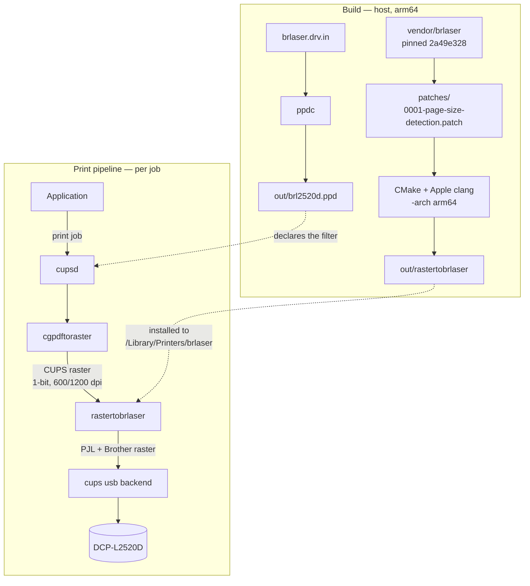

<!-- SPDX-License-Identifier: GPL-3.0-or-later -->

# Technical notes

For people maintaining, auditing, or rebuilding this driver.

## Why this exists

Brother's macOS driver for the DCP-L2520D contains no arm64 code. On Apple
silicon the per-job filter is an x86_64 binary that must be translated by
Rosetta 2:

```
execv of .../rastertobrother2300 failed. err:86, Bad CPU type in executable
STATE: +com.apple.badarch-error
```

That failure appears when Rosetta is missing and returns whenever it is
unavailable. Apple has said Rosetta's scope narrows after macOS 27, so the vendor
driver has a limited future regardless.

The DCP-L2520D is a host-based printer: no PCL, no PostScript, no AirPrint, no
network interface. It only accepts Brother's proprietary raster command set, so
a filter must encode that format.

## What this does

Builds [brlaser](https://github.com/pdewacht/brlaser) as a native arm64 CUPS
filter, applies one local patch, and points the queue at it. brlaser is an
independent implementation of Brother's raster protocol with a verified entry for
this model. No Brother code is used, wrapped, or emulated.

## Pipeline



The PPD declares `application/vnd.cups-raster 33 rastertobrlaser` and pins the
input to 1-bit monochrome via `cupsBitsPerColor 1` and `cupsColorSpace 3`.
`cgpdftoraster` renders the document into CUPS raster; the filter reads each page
header, derives print parameters, emits PJL framing, encodes the pixels with
Brother's compression (runs, repeats, substitutions, diffed against the previous
line, 64 lines per band), and hands the result to the USB backend.

Source layout: `main.cc` is the filter entry and header translation, `job.cc`
owns PJL framing and the band loop, `line.cc` the compression primitives,
`block.h` the line accumulator, `brdecode.cc` the decoder used only in tests.

## Build

```sh
./build.sh
```

Two details worth knowing. Modern CMake rejects brlaser's
`cmake_minimum_required(VERSION 3.1)`, so the build passes
`-DCMAKE_POLICY_VERSION_MINIMUM=3.5`. And `ppdc` emits 34 PPDs while only
`brl2520d.ppd` is kept; its `cupsFilter` line is rewritten to an absolute path
because CUPS resolves bare filter names against `/usr/libexec/cups/filter`, not
where this driver installs.

## Test

```sh
./test.sh
```

- brlaser's own unit tests via `ctest`
- text → CUPS raster → filter → bitmap, checking the 128-byte null prologue and
  PJL/PCL framing
- exact placement: a deterministic black band must decode to the same rows and
  span the full width
- paper-size detection across the whole table, landscape, the tolerance boundary
  either side, a 4×6in page that must not snap onto A6, and the integer
  `PageSize` fallback

No paper is used.

## The local patch

`vendor/patches/0001-page-size-detection.patch` changes `build_page_params()`:

- Upstream resolves paper size only from `cupsPageSizeName` and falls back to a
  hardcoded `A4`.
- The patch falls back to page geometry (`cupsPageSize`, then `PageSize`) against
  a table of dimensions in points, 2 pt tolerance, portrait or landscape.

| Geometry | Upstream | Patched |
| --- | --- | --- |
| 595×842 (A4) | A4 | A4 |
| 420×595 (A5) | **A4** | **A5** |
| 612×792 (Letter) | **A4** | **LETTER** |
| 612×1008 (Legal) | **A4** | **LEGAL** |
| 288×432 (4×6in) | A4 | A4 |

Applying the patch to upstream `2a49e328` reproduces `vendor/brlaser/` exactly.

## Installer behaviour

`install.sh` requires root, refuses a non-arm64 filter, refuses a PPD that does
not reference the installed filter path, and preserves the queue's original PPD
at `/Library/Printers/brlaser/backup/<queue>.ppd.original` — never overwritten.
If anything fails after the queue is switched, it restores the snapshot.

If the queue does not exist it is created against the printer found on USB. It
records whether it created or repointed the queue so `uninstall.sh` knows which
to undo.

## Verification status

Verified:

- Mach-O arm64, no Intel slices, linking only `libcups`, `libc++`, `libSystem`
- exact encode/decode round-trips
- encoded output printed correctly on a physical DCP-L2520D, sent directly to the
  USB endpoint
- the full paper-size table and its boundaries

Not verified:

- the queue path end to end (application → cupsd → PPD → filter → backend) on a
  fresh install; the hardware test bypassed cupsd
- more than one printer or host

`migrate.sh` is ordered so that removing Brother's Intel driver requires a queue
job to reach completed state with no filter or transport errors in
`/var/log/cups/error_log`.

## Diagnostics

`tools/pjlquery.c` sends one PJL command over the printer-class USB interface and
prints the reply. Useful for checking what the device reports:

```sh
./out/tools/pjlquery "DCP-L2520D" "@PJL INFO STATUS"
./out/tools/pjlquery "DCP-L2520D" "@PJL DINQUIRE PAPER"
```

`DINQUIRE PAPER` returns the size configured on the printer's panel. It is a
setting, not a measurement — this model has no paper-width sensor.

`tools/mkraster.c` writes a synthetic CUPS raster for tests.

## Limitations

- No toner or paper status UI; Brother's `BrStatusMonitor` is not replaced.
- No secure print, humidity level, or sleep-mode settings.
- 600 and 1200 dpi only.
- Single model, USB only.

## License

GPL-3.0-or-later. `LICENSE` holds the text. `NOTICE.md` explains why the filter
cannot be permissive and records the brlaser attribution and vendored commit.
